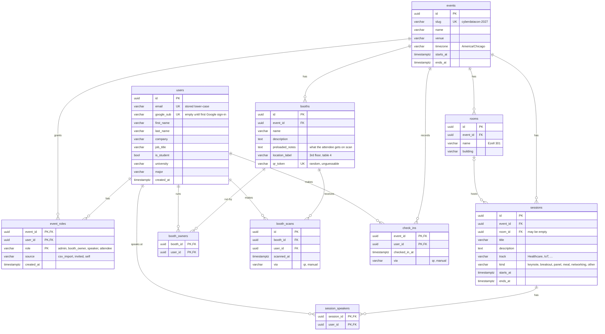

# Database

The current shape of the Event Companion database (PostgreSQL 16).

- **Source of truth:** [`backend/app/models.py`](../backend/app/models.py). Alembic builds the
  real tables from it.
- **Why it looks like this:** [ADR 0003](decisions/0003-v1-data-model.md). The diagram in the ADR
  is the design as it was *proposed*; this page is the database as it is *now*.
- **Last updated:** 2026-11-13, at migration `20261020_0001_create_v1_tables`.

> **Rule:** any pull request that adds, removes or changes a table or column updates this page
> in the same PR. If this page and `models.py` disagree, `models.py` wins and this page has a bug.

## The picture

## How to read the lines

| Symbol | Means |
|---|---|
| `\|\|` | exactly one |
| `\|o` | zero or one |
| `o{` | zero or many (the "crow's foot") |

So `events ||--o{ booths` reads: *one event has zero or many booths, and every booth belongs to
exactly one event.* And `rooms |o--o{ sessions` reads: *a session is in zero or one room*. That's
Dr. Simmons's "rooms are fluid" rule: a session can be on the agenda before it has a room.

**PK** is the primary key (what makes a row unique), **FK** is a foreign key (a pointer to a row in
another table), and **UK** is a unique column (no two rows may share the value).

## The three groups

1. **People:** `users` and `event_roles`. A person exists once in `users`. What they *are* at a
   given event lives in `event_roles`, so one person can be an attendee, a speaker *and* a booth
   owner without being copied three times.
2. **The program:** `events`, `rooms`, `sessions`, `session_speakers`. The agenda importer
   (PR #2) fills these.
3. **The lead exchange:** `booths`, `booth_owners`, `booth_scans`, `check_ins`. A scan is one row
   in `booth_scans`: *this attendee visited this booth.*

`session_speakers`, `booth_owners` and `event_roles` are **link tables**. They exist only to
connect two other tables in a many-to-many way.

## Rules the database itself enforces

These are checked by Postgres, not just by Python, so even a hand-typed SQL insert in pgAdmin
can't break them.

| Table | Rule | Why |
|---|---|---|
| `users` | `email` must be lower-case and unique | `Tio@X.com` and `tio@x.com` are the same person |
| `users` | `google_sub` is unique | one Google account = one user |
| `event_roles` | `role` is one of the four roles; `source` is one of the three sources | no made-up roles like "king" |
| `event_roles` | (event, user, role) can't repeat | the same role can't be granted twice |
| `rooms` | (event, name) can't repeat | one "Ezell 301" per event |
| `sessions` | `ends_at > starts_at`; `kind` from the allowed list | no sessions that end before they start |
| `booths` | `qr_token` is unique | each printed QR code points to exactly one booth |
| `booth_scans` | (booth, user) can't repeat | a retried scan from a phone that was offline can't create a second lead (idempotent) |
| `check_ins` | one per (event, user) | you arrive once |

## What happens on delete

- Deleting an **event** deletes its rooms, sessions, booths, roles, scans and check-ins
  (`ON DELETE CASCADE`).
- Deleting a **user** deletes their roles, speaker links, booth-owner links, scans and check-ins.
- Deleting a **room** does *not* delete its sessions. They just lose their room
  (`ON DELETE SET NULL`).

## Not in the database yet

From the requirements, planned for later migrations: speaker "ready?" confirmations, booth-owner
checklists, attendee notes and saved key points, and map coordinates (PostGIS) if a venue map
comes back into scope.

## Change log

| Date | Migration | Change |
|---|---|---|
| 2026-10-20 | `20261020_0001_create_v1_tables` | First ten tables (ADR 0003) |
