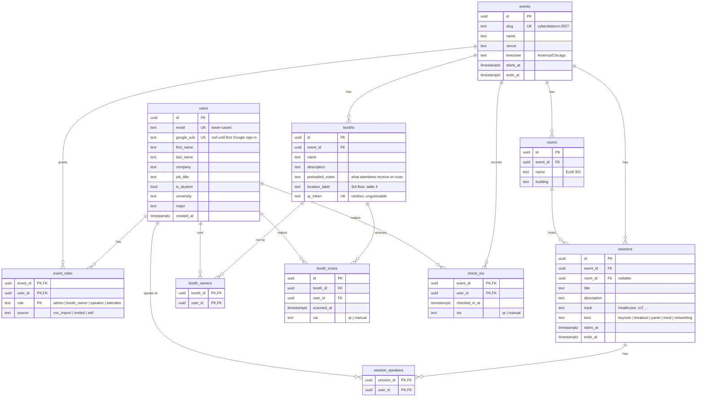

# 0003: v1 data model

## Status

Accepted, 2026-10-20

## Context

ADR 0001 picked PostgreSQL; ADR 0002 picked SQLAlchemy + Alembic. Before writing any
model classes we need to agree on *what* the tables are, because tables are the most
expensive thing to change later (every change is a migration, and real attendee data
has to survive it).

What the schema must support, from Dr. Simmons's requirements (2026-10-05):

- **One event for v1** (CyberDataCon, April 2027), but nothing should assume there is only one.
- **Google sign-in.** Registrants arrive first as a **CSV export** from the event CRM.
- **Four roles:** admin/organizer, booth owner, speaker, attendee. One person can hold
  more than one (some speakers also run booths).
- **Booth QR scan = lead exchange.** Attendee scans the booth's code; the attendee gets
  the booth's preloaded notes, and the booth owner gets the attendee's profile.
- **Attendee profile:** company, role/title, student yes/no; if student, university and major.
- **Agenda:** sessions in named rooms (Ezell 301, Swang 108, Ezell Chapel), with tracks.
- **No map in v1**, so no coordinates and no PostGIS yet.
- Later (not in the first migration): speaker "ready?" confirmations, booth-owner
  checklists, attendee notes, saved key points.

## Proposed tables (first migration)

## Design choices in this proposal (and why)

1. **UUID primary keys, not 1, 2, 3...**
   - The offline sync queue (from the prototype) needs the *phone* to create IDs before
     the server has seen the record. UUIDs can be generated anywhere without collisions.
   - Sequential IDs leak information (`/booths/7` tells you there are about 7 booths) and invite
     people to try `/booths/8`. Authorization still has to be enforced, but there's no reason to make guessing easy.
   - Cost: 16 bytes instead of 4–8, and harder to read while debugging. Fine at our scale.

2. **Roles live on `event_roles`, not on `users`.**
   A person is an attendee at *this* event and might be a speaker at next year's. The
   primary key `(event_id, user_id, role)` lets one person hold several roles at once.

3. **Booth QR codes carry a random `qr_token`, not the booth ID.**
   If the code were `booth://<id>`, anyone could make a fake scan of every booth from home.
   The token is a long random string the server looks up. If a code leaks, we
   rotate the token without changing the booth.

4. **`booth_scans` is the lead-exchange record.** Unique on `(booth_id, user_id)`: scanning
   twice is still one lead, which makes retries from the offline queue harmless (idempotent).
   The booth owner's "leads" view is a query joining `booth_scans → users`, and the API
   decides which profile fields it returns (ADR 0002: separate API classes).

5. **Profile fields on `users`.** Company, student status and so on describe the person, not
   their attendance. If consent turns out to be per event, we add a consent column to
   `event_roles` later.

6. **All times are `timestamptz`** (stored in UTC), plus a `timezone` on the event for display.
   Avoids the classic "session shows an hour off after daylight saving" bug.

7. **Deferred to later migrations:** speaker confirmations, checklists/notifications, notes,
   key points and saved points, friends, map coordinates/PostGIS.

## Decisions (Tio, 2026-10-20)

- **CSV registrants:** the import pre-creates `users` rows by email (and an `attendee`
  row in `event_roles` with `source = csv_import`). On first Google sign-in, if Google
  says the email is verified and it matches, we fill in `google_sub` on that row.
- **Friends:** deferred out of v1. Dr. Simmons didn't ask for it; agenda + booth lead
  exchange come first.
- **Local development database:** native PostgreSQL 17 on Windows (not Docker, not hosted).

Design choices 1–6 reviewed and accepted by Tio on 2026-10-20.
