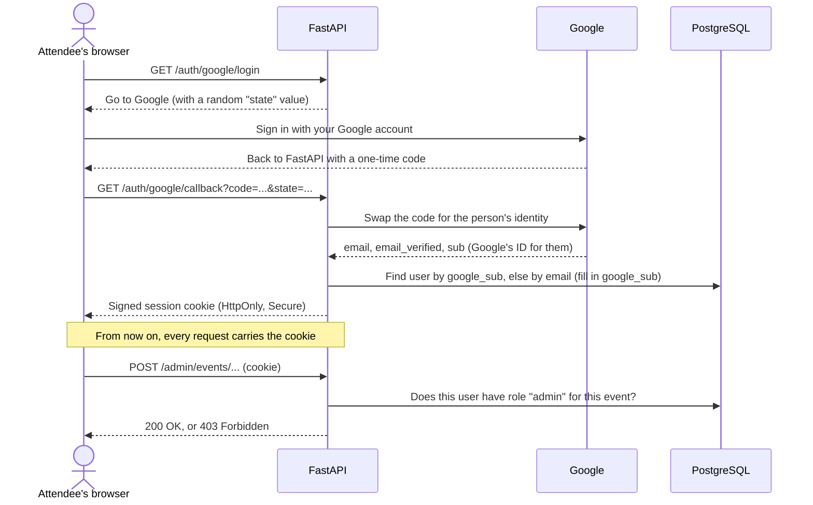

# 0004: Google sign-in and who-can-do-what

## Status

**Proposed**, 2026-11-13. Tio picks an option below, then this becomes Accepted.

## Context

Two features are blocked on sign-in:

- **The booth scan** (lead exchange) has to know *who* scanned, so the booth gets the right profile.
- **The `/admin` pages** (create event, upload CSVs, print QR codes) are open to anyone right now.
  They must be locked to admins before anything goes online.

What we already know:

- Dr. Simmons wants **Google sign-in**, with regular Google accounts, not school ones (requirements, 2026-10-05).
- ADR 0001 says **all authorization lives in FastAPI**. The browser never talks to the database.
- ADR 0003 says CSV registrants exist *before* they sign in. On their first **verified** Google
  sign-in we fill in `users.google_sub` and link them by email.
- The React frontend doesn't exist yet. Whatever we pick should be testable today, from the browser.

Two words to keep apart 🧠:

- **Authentication** answers *"who are you?"* Google does this part.
- **Authorization** answers *"what are you allowed to do?"* Our `event_roles` table does this part, enforced in FastAPI.

## The options

All three options use Google. The difference is **who talks to Google** and **who keeps you signed in**.

| | A. FastAPI talks to Google (recommended) | B. React gets a Google token, FastAPI checks it | C. A hosted auth service (Supabase Auth, Auth0, Firebase) |
|---|---|---|---|
| How it works | The browser goes to `/auth/google/login`. Google sends the person back to FastAPI with a one-time code, and FastAPI swaps it for their identity | A Google button in React gets an ID token, and React sends it to FastAPI to verify | The service does Google for us and gives us its own token. FastAPI verifies that token |
| Works before React exists? | **Yes**: just open a URL in the browser | No: needs a frontend button | Partly |
| Where secrets live | Only on the server | Server (no Google secret needed) | With the service |
| What you learn | The real OAuth 2.0 / OpenID Connect flow, cookies, sessions | Token verification | Configuring a vendor |
| New moving parts | One Python library (Authlib) | Google's JS library + `google-auth` | A whole extra service + account |
| Adding email sign-in later | We'd build it (magic links) | We'd build it | Built in |

## Recommendation: A

Why A:

1. **It fits ADR 0001.** The server owns both halves: Google proves who you are, and FastAPI decides what you can do.
2. **You can try it today**, by opening a link in the browser. No React needed yet.
3. **No new service** to sign up for, pay for or learn. It's one library.
4. **It's the version worth explaining in an interview** 🧠. "Authorization code flow, state parameter, HttpOnly session cookie" is exactly the OAuth vocabulary AI-engineering and backend roles ask about.

The cost: if Dr. Simmons later wants **email sign-in** too (open question 4), we build magic links ourselves. That's a contained feature, and option C is still possible later because the `users` table doesn't care how someone proved who they are.

## Smaller choices that come with A

1. **Keeping you signed in:** a signed session cookie (`HttpOnly`, `Secure`, `SameSite=Lax`), not a token stored in JavaScript. JavaScript can't read the cookie, which protects it from XSS.
2. **Linking:** match on `google_sub` first. If there's none, match on email, **only if Google says `email_verified` is true**. Otherwise anyone could claim a registrant's email.
3. **Unknown people:** someone who signs in but isn't in the CSV becomes a user with **no role**. They can see the public agenda, and an admin can grant them a role. *(This one is Dr. Simmons's call; we can change it without a migration.)*
4. **The lock:** one FastAPI dependency, `require_role("admin")`, on every `/admin` route. It's tested so that an attendee gets `403` and someone not signed in gets `401`.
5. **The first admin:** set by an `ADMIN_EMAILS` setting in `.env`, so Tio and Dr. Simmons can get in before any roles exist.

## Consequences

- You (Tio) create a free **OAuth client** in Google Cloud Console once. It's clicks only, and there will be a step-by-step guide.
- A new `.env` value holds the Google client secret and the cookie-signing key. Git ignores `.env`.
- No database migration is needed: `users.google_sub` already exists (ADR 0003).
