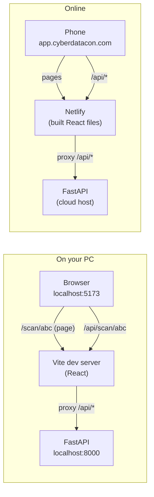

# 0005: The frontend: Vite + React + TypeScript, one address with /api

## Status

**Accepted**, 2026-11-25. Tio chose all three recommended options below.

## Context

The backend can now do the app's main job: import the event, sign people in with Google, and
record booth scans (PR #6). But nobody can *use* it without opening `/docs`. The next step is the
app attendees actually hold in their hand.

What's already decided:

- **ADR 0001:** React + TypeScript, installable as a PWA, served from Netlify. FastAPI does all the
  rules, so the browser never talks to the database.
- **ADR 0004:** sign-in is a **cookie** (`ec_session`): signed, HttpOnly, `SameSite=Lax`.
  JavaScript can't read it. The browser just sends it.
- **The QR codes:** each printed code opens `{APP_BASE_URL}/scan/{token}`. That link has to open a
  **page**, not raw JSON.
- **The requirements:** phones on busy conference Wi-Fi, mostly one-handed use, and the booth scan
  comes first (decision 2026-11-18).

The questions: how does React reach the API without breaking the cookie? How does it fetch data?
How do we style it?

## Decision 1: One address. The API lives under `/api` 🧠

Browsers treat `localhost:5173` and `localhost:8000` as **two different sites**, just like
`cyberdatacon.netlify.app` and `api.somewhere.com`. A `SameSite=Lax` cookie is **not sent** when a
page on one site calls `fetch()` on another. So if React and FastAPI live at two addresses, sign-in
"works" but every API call afterwards says 401.

| | A. Same address via `/api` (chosen) | B. Two sites + CORS |
|---|---|---|
| How | React calls `/api/...`; a proxy forwards it to FastAPI | React calls `https://api.x.com/...` directly |
| Cookie | Just works (same site) | Needs `SameSite=None; Secure` and `credentials: "include"` everywhere |
| Extra setup | One proxy rule (Vite in dev, Netlify in prod) | CORS allow-list, preflight requests, HTTPS even in dev |
| Security | `Lax` keeps blocking cross-site POSTs | `None` means we must add CSRF protection ourselves |

So **every API path now starts with `/api`** (`/api/scan/{token}`, `/api/auth/me`,
`/api/admin/...`, docs at `/api/docs`). React owns every other path. That neatly separates
**`/scan/abc`**, the page the phone camera opens, from **`/api/scan/abc`**, the JSON behind it.

## Decision 2: Fetch data with TanStack Query

Every screen asks the API for something, and every request can be *loading*, *failed* or *done*.
Plain `fetch` + `useEffect` means writing that by hand on every page, plus retries and caching.
TanStack Query does it once:

- **Caching:** go back to "My booths" and it shows instantly while it refreshes.
- **Retry:** a request that drops on bad Wi-Fi tries again by itself.
- **Mutations:** the "Share my profile" button gets `isPending` for free, so a double-tap can't
  send twice from the UI (the server is already race-proof, PR #6).

We still write one small `api.ts` with typed `fetch` calls. TanStack Query decides *when* to call them.

## Decision 3: Plain CSS with variables

One `.css` file per component, plus design tokens (colors, spacing, fonts) as CSS variables in
`tokens.css`, reusing the look of the clickable prototype (`index.html` in the repo root).
There's nothing new to learn, and the styles stay readable for whoever maintains this after us.

## Smaller choices (defaults, no debate needed)

- **Build tool:** Vite (`npm create vite@latest`, React + TypeScript template).
- **Pages:** React Router, with routes `/`, `/scan/:token`, `/visits`, `/my-booths`,
  `/my-booths/:id`, and the agenda.
- **API types:** hand-written TypeScript interfaces that mirror `schemas.py` for now. Later we can
  generate them from `/api/openapi.json`.
- **PWA:** `vite-plugin-pwa` (manifest + service worker) once the first screens work.
- **Folder:** `frontend/` next to `backend/`, as planned in the project instructions.

## Consequences

- ✅ The backend moved under `/api` in this PR. All 68 tests pass, and a new test checks that
  `/scan/...` is **not** an API path any more.
- ⚠️ **Google redirect URIs change** to `.../api/auth/google/callback`. Tio updates them in Google
  Cloud (`docs/google-sign-in-setup.md`, step 3), or sign-in shows `redirect_uri_mismatch`.
- ⚠️ **At deploy time:** FastAPI builds the Google redirect URI from the request's host. Behind
  Netlify's proxy that host may be the backend's, not `app.cyberdatacon.com`. We'll fix it then
  (trust `X-Forwarded-Host`, or build it from `APP_BASE_URL`) and test sign-in on the real address.
- 🔜 First frontend PR: the scan page (`/scan/:token` → preview → sign in → "Share my profile" →
  the booth's notes).
