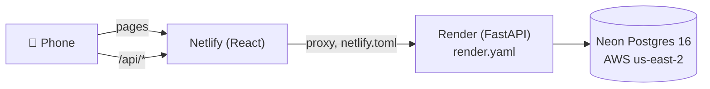

# 0006: Hosting: Netlify + Render + Neon

## Status

**Accepted**, 2026-11-25. Tio chose Render for the API, Neon for Postgres, and his own accounts for now.

## Context

The app works on Tio's PC (scan, leads, agenda, installable PWA). Dr. Simmons needs a link he can
open on his phone, and the event (April 2027) needs something reliable. ADR 0001 already put the
React app on **Netlify**. ADR 0005 requires that the phone sees **one address**, with `/api/*`
forwarded to FastAPI. Still open: where do FastAPI and PostgreSQL run, and whose accounts are they?

## Options considered

| | **Render API + Neon Postgres (chosen)** | Render for both | Railway for both |
|---|---|---|---|
| Cost while building | Free | DB free for only 30 days, then deleted unless you upgrade | Small monthly bill, no free tier |
| Dashboards | Two | One | One |
| Deploys | Every push to `main` (Blueprint: `render.yaml`) | Same | Same |
| Catch | Free API sleeps after 15 min (about 1 min to wake) | Same, plus the DB deadline | None big |

Render's free web service sleeps after 15 minutes idle, and its free Postgres expires after
30 days (render.com/docs/free, checked 2026-11-25). Neon's free Postgres doesn't expire, so we
can build for months at no cost.

## Decision

- **Netlify** builds `frontend/` and proxies `/api/*` to Render (`netlify.toml`).
- **Render** runs `alembic upgrade head` then uvicorn on every deploy (`render.yaml`, region Ohio).
- **Neon** holds the database, in the same region as Render to keep queries fast.
- **Accounts:** Tio's (GitHub sign-in) for the demo phase. Before the event, move them to a
  CyberDataCon-owned account with Tio as admin (matches the ownership plan from meeting 2).

## Two code changes this needed 🧠

1. **`OAUTH_CALLBACK_URL` setting.** Behind Netlify's proxy, FastAPI sees the request arriving at
   Render's address, so `url_for()` would tell Google "send them back to `onrender.com`".
   The cookie would then land on the wrong site. Online we now state the address explicitly.
   On your PC it stays empty and works as before. (This was the deploy-time ⚠️ in ADR 0005.)
2. **Database links.** Neon and Render give `postgresql://...`; SQLAlchemy needs
   `postgresql+psycopg://...`. `Settings` now adds the driver part for you.

## Consequences

- ✅ $0 while building. Step-by-step setup is in `docs/deploy.md`.
- ✅ Merge to `main` = deployed. Secrets live only in dashboards.
- ⚠️ **Cold starts:** the first visit after 15 idle minutes waits about a minute. Fine for demos.
  **Before April, switch Render to an always-on plan** (check current pricing then).
- ⚠️ Google's consent screen stays in **Testing** (only listed test users) until we publish it.
- 🔜 Move accounts to CyberDataCon; custom domain `app.cyberdatacon.com` (DNS from Dr. Simmons),
  which means updating `APP_BASE_URL`, `OAUTH_CALLBACK_URL` and Google's redirect URIs.
