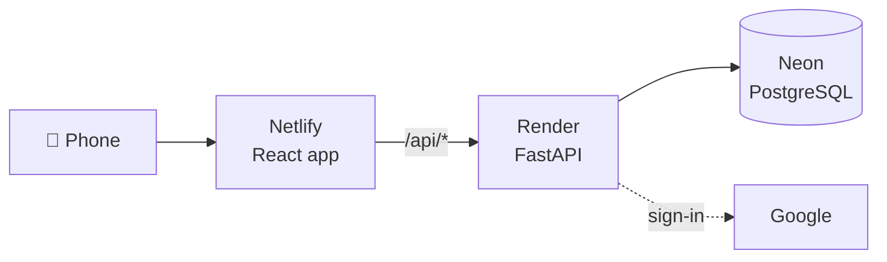

# Putting Event Companion online

Three free services, all signed in with **your GitHub** (Tio's accounts for now; we move them to a
CyberDataCon account before the event, ADR 0006). Do the steps in this order: each one needs
something from the one before.

## 1. Neon: the database (5 min)

1. Go to **neon.tech** → **Sign up** → **Continue with GitHub**.
2. **Create project**: name `event-companion`, Postgres **16**, region **AWS US East 2 (Ohio)**.
3. On the project dashboard, click **Connect**. Copy the **connection string**
   (it starts with `postgresql://` and ends with `?sslmode=require...`). Keep the tab open.

> It's fine that it says `postgresql://`. The app adds the `+psycopg` driver part for you.

## 2. Render: the API (10 min)

1. Go to **render.com** → **Get Started** → **GitHub**. Allow access to `event-companion`.
2. **New +** → **Blueprint** → pick the `event-companion` repo → Render reads `render.yaml`.
3. It asks for the values marked `sync: false`. Fill in what you have now:
   - `DATABASE_URL`: the Neon string from step 1
   - `GOOGLE_CLIENT_ID` / `GOOGLE_CLIENT_SECRET`: the same two values as in your `backend/.env`
   - `ADMIN_EMAILS`: your Gmail
   - `APP_BASE_URL` and `OAUTH_CALLBACK_URL`: type `TBD` for now (we fill them in at step 4)
4. **Apply**. Wait for the deploy to turn green (the first one takes a few minutes).
5. Open **https://event-companion-api.onrender.com/api/health**. You should see `{"status":"ok"}`.
   - Render shows the real address at the top of the service page. **If it's different**
     (e.g. `event-companion-api-x1y2.onrender.com`), change the address in `netlify.toml`
     (the `to = ...` line), or tell Claude.
6. Open `/api/health/db`. The table list proves Render reached Neon and Alembic built the tables.

## 3. Netlify: the app (5 min)

1. Go to **netlify.com** → **Sign up** → **GitHub**.
2. **Add new site** → **Import an existing project** → **GitHub** → `event-companion`.
   Netlify reads `netlify.toml`, so leave the build settings as they are → **Deploy**.
3. **Site configuration** → **Change site name** → e.g. `cyberdatacon-companion`.
   Your app is now at **https://cyberdatacon-companion.netlify.app**.

## 4. Connect the pieces (5 min)

1. **Render** → your service → **Environment**:
   - `APP_BASE_URL` = `https://cyberdatacon-companion.netlify.app`
   - `OAUTH_CALLBACK_URL` = `https://cyberdatacon-companion.netlify.app/api/auth/google/callback`
   - **Save, rebuild, and deploy**.
2. **Google Cloud** → your OAuth client → **Authorized redirect URIs** → **Add URI**:
   `https://cyberdatacon-companion.netlify.app/api/auth/google/callback` → **Save**.
   (Keep the localhost ones, so your PC still works.)
3. While the consent screen is in **Testing**, only your **test users** can sign in. Add
   Dr. Simmons's Gmail there for the demo. Publishing it for everyone comes before the event.

## 5. Try it 🎉

1. Open the Netlify address on your phone → **Sign in with Google** → you're back, signed in.
2. In `https://cyberdatacon-companion.netlify.app/api/docs`, create the event
   (`slug`: `cyberdatacon-2027`) and upload the registrants / agenda / booths CSVs, just like on your PC.
3. Print a booth's QR code, scan it with your phone, and share. Then check the booth's leads.
4. Chrome on Android: menu → **Install app**. iPhone Safari: Share → **Add to Home Screen**.

## Good to know

- **The free Render server sleeps** after 15 minutes with no visitors. The first visit afterwards
  waits about a minute while it wakes up, and may show "Can't reach the server". Try again.
  Before the event, switch the service to a paid always-on plan (Render → Settings → Instance type).
- **Every merge to `main` redeploys** both Netlify and Render by themselves.
- Secrets live only in the Render dashboard (and your `.env`), never in GitHub.
