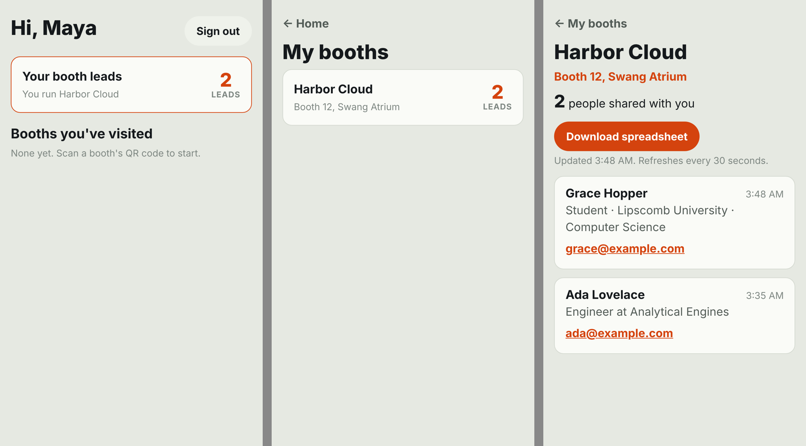
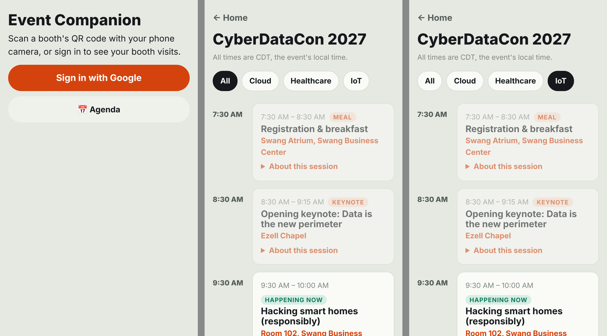

# Event Companion: the app (React + TypeScript)

Why it's built this way: [ADR 0005](../docs/decisions/0005-frontend.md).

## Run it (VS Code: Terminal → Run Task…)

1. **3. Start the API** (FastAPI on port 8000)
2. **6. Install app packages** (first time only)
3. **7. Start the app** → open **http://localhost:5173**

Optional: copy `.env.example` to `.env` so the signed-out home page links to the event's agenda.

Use `localhost` (not `127.0.0.1`) so the sign-in cookie and Google's redirect match.

To try a scan: in `http://localhost:8000/api/docs`, run **GET /api/admin/events/{slug}/booths**,
copy a booth's `qr_link` (it looks like `http://localhost:5173/scan/...`) and open it.

## Installable + offline (PWA)

`npm run dev` doesn't run the service worker. To try the real thing: `npm run build`, then
`npx vite preview --port 5173` (with the API running). In Chrome, the address bar shows **Install**.
The app shell and the last agenda you opened still load with no signal. Personal data (sign-in,
leads, visits) is never cached. The rules are in `vite.config.ts`.

## Where things live

| File | What it does |
|---|---|
| `vite.config.ts` | Dev server on 5173; forwards `/api/*` to FastAPI (the one-address rule); PWA manifest + what the service worker caches |
| `public/` | App icons (placeholder design: a booth-code square with a ✓) |
| `src/api.ts` | Every call to the API. Turns FastAPI's `{"detail": ...}` into a readable `ApiError` |
| `src/types.ts` | TypeScript copies of `backend/app/schemas.py` |
| `src/queries.ts` | TanStack Query setup: when to retry, cache keys, `useMe()` |
| `src/App.tsx` | The list of pages (routes) |
| `src/pages/ScanPage.tsx` | `/scan/:token`: booth preview → sign in → Share my profile → notes |
| `src/pages/HomePage.tsx` | `/`: who you are, your booth leads (if you run a booth), booths you've visited |
| `src/pages/MyBoothsPage.tsx` | `/my-booths`: booths you run, with lead counts |
| `src/pages/BoothLeadsPage.tsx` | `/my-booths/:boothId`: the leads, refreshing every 30 s, plus the CSV download |
| `src/pages/AgendaPage.tsx` | `/events/:slug/agenda`: the schedule in the event's time zone, track filter, "Happening now" |
| `src/agenda.ts` | Pure agenda helpers (group by day/slot, time zone formatting, filters) |
| `src/components.tsx` | Small shared pieces (the "Sign in first" screen) |
| `src/test-utils.tsx` | Fake API + render helpers for the tests |
| `src/styles/tokens.css` | Colors and fonts from the prototype, light and dark |

