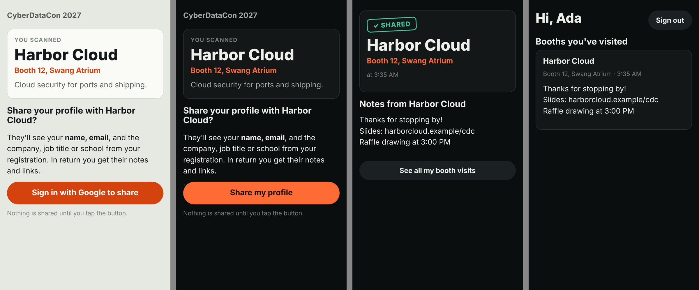

# Event Companion: the app (React + TypeScript)

Why it's built this way: [ADR 0005](../docs/decisions/0005-frontend.md).

## Run it (VS Code: Terminal → Run Task…)

1. **3. Start the API** (FastAPI on port 8000)
2. **6. Install app packages** (first time only)
3. **7. Start the app** → open **http://localhost:5173**

Use `localhost` (not `127.0.0.1`) so the sign-in cookie and Google's redirect match.

To try a scan: in `http://localhost:8000/api/docs`, run **GET /api/admin/events/{slug}/booths**,
copy a booth's `qr_link` (it looks like `http://localhost:5173/scan/...`) and open it.

## Where things live

| File | What it does |
|---|---|
| `vite.config.ts` | Dev server on 5173; forwards `/api/*` to FastAPI (the one-address rule) |
| `src/api.ts` | Every call to the API. Turns FastAPI's `{"detail": ...}` into a readable `ApiError` |
| `src/types.ts` | TypeScript copies of `backend/app/schemas.py` |
| `src/queries.ts` | TanStack Query setup: when to retry, cache keys, `useMe()` |
| `src/App.tsx` | The list of pages (routes) |
| `src/pages/ScanPage.tsx` | `/scan/:token`: booth preview → sign in → Share my profile → notes |
| `src/pages/HomePage.tsx` | `/`: who you are + booths you've visited |
| `src/styles/tokens.css` | Colors and fonts from the prototype, light and dark |

